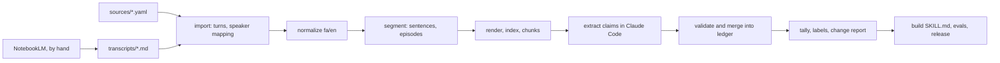

# 00. Project overview and session plan

**Project:** Resume Review Skills (working repo name `resume-reviewer`, CLI and package `rrs`)
**Spec version:** 1.1, written 2026-10-18 from the v0.1 session; 2026-10-19: automatic transcription dropped, the pipeline starts from hand-made NotebookLM transcripts; the v0.1 baseline (ledger, `build.py`, SKILL.md) dropped, the ledger and skill are rebuilt from the transcripts
**Read this first.** Specs 01 to 03 each describe one phase and are written so a fresh Claude Code session can execute them without the original conversation.

## 1. Purpose

Turn public interviews with recruiters and hiring managers into a structured text corpus, extract atomic claims about how CVs are screened, aggregate them into rules ranked by how many distinct recruiters agree, and generate a resume-review skill from those rules.

The owner makes each transcript by hand in NotebookLM and commits it to `transcripts/`. The repo starts there: it does not download media, transcribe or diarize.

The goal of the skill is a higher interview-invitation rate, not a nicer-looking CV. Every rule must trace back to a quote in a transcript. No general resume advice is allowed in.

**Rules are statistical facts** (owner, 2026-10-19; ADR 0003). The value of a rule is the number of distinct recruiters who state it, so every count must be exact: rules are worded only from claims already collected, a claim maps to a rule only when the recruiter states that rule, and quantities (pages, seconds) are recorded as values and reported as distributions across recruiters. The specs change whenever this principle needs it; the project is meant to keep evolving as sources are added.

## 2. Status at handoff (v0.1)

| Item | State |
|---|---|
| Sources | 4 interviews, transcribed with NotebookLM (text only, 3 of 4 without timestamps) |
| Claims | 194 atomic claims: JA 68, SB 44, TW 44, JB 38 |
| Rules | 90 in the index: 28 Consensus, 26 Supported, 6 Contested, 24 Single source, 6 out of scope (X-) |
| Skill | `resume-reviewer`, SKILL.md of 213 lines, proposed for saving on claude.ai |
| Tooling | `build.py`: tallies the markdown ledger and regenerates the rules block of SKILL.md between `<!-- RULES:START -->` and `<!-- RULES:END -->` |

The v0.1 transcripts are in `transcripts/`. The other v0.1 files (ledger, `build.py`, SKILL.md) are **not** carried over (owner decision, 2026-10-19): the ledger starts empty, every source is extracted again with the protocol in 02 section 7, and SKILL.md is written fresh in Phase 3. The v0.1 numbers above are history only.

v0.1 sources and their new IDs:

| New ID | Transcript file | Guest (code) | Host | Language | Format |
|---|---|---|---|---|---|
| S001 | `John Adib, engineering Manager.md` | John Adib (JA), engineering manager, London | Sahar (H01), co-host | Persian with English tech terms | Live review of 31 CVs, about 2 hours |
| S002 | `Sam Baldwin, JavaScript recruiter.md` | Sam Baldwin (SB), agency, UK startups | John Adib (JA) | English | Interview |
| S003 | `Tomasz Wojtyczko, Principal Recruitment Consultant at VirtueTech.md` | Tomasz Wojtyczko (TW), agency, UK and Europe | John Adib (JA) | English | Interview, about 55 minutes |
| S004 | `Joe Bignell, Talent Acquisition Specialist.md` | Joe Bignell (JB), ex-agency, EMEA and US | John Adib (JA) | English | Interview |

The YouTube URLs were not preserved in the transcript files (they read `[YOUTUBE URL]` or are missing). They stay `null` in the source YAMLs until known; nothing depends on them.

## 3. Decisions

| ID | Decision | Why |
|---|---|---|
| D1 | Python 3.12, managed with `uv`; CLI with Typer; schemas with Pydantic | The Persian NLP ecosystem is Python-first |
| D2 | Transcripts are made **by hand in NotebookLM**, one Markdown file per source in `transcripts/`. The repo does no downloading, transcription or diarization | Owner's choice; automating transcription is out of scope for now |
| D3 | **Private** GitHub repo. Transcripts and everything derived from them (corpus, ledger) are committed. No media in the repo | Owner's choice; keeps the repo small |
| D4 | Claim extraction runs **inside Claude Code sessions**, chunk by chunk, against a schema. Deterministic scripts validate everything. No Anthropic API key needed | Owner's choice; matches how v0.1 was done |
| D5 | The corpus is verbatim. `text` holds what the transcript says; matching and search use separate normalized fields | Quotes must stay faithful; normalization must never change evidence |
| D6 | Every claim anchors to a sentence ID and an exact quote that `rrs ledger validate` can find, plus a timestamp when the transcript has them | v0.1 could not verify anchors automatically |
| D7 | Counting rules from v0.1 stay as they are unless an ADR changes them (spec 02, section 8) | Keeps labels comparable across versions |
| D8 | Generated files are never hand-edited: `ledger/claims-ledger.md`, the rules block and evidence table in `skill/SKILL.md`, `reports/*` | One source of truth: the JSONL ledger and YAML configs |
| D9 | No em-dashes (or en-dashes) in any generated prose, templates or the skill | Owner preference; also rule RED-8 (screeners read them as an AI tell) |
| D10 | Rules are statistical facts: worded from collected claims only, mapped only from direct statements, quantities measured as distributions (ADR 0003) | The skill's authority is the count of recruiters behind each rule |

Record any change to these as an ADR in `docs/decisions/` (template in section 11).

## 4. Pipeline



| Phase | Spec | Main output |
|---|---|---|
| 1 Import, normalize and segment | 01 | `corpus/Sxxx/transcript.json`, renders, index, chunks |
| 2 Claims and ledger | 02 | `ledger/claims.jsonl`, tally, change report |
| 3 Skill build and eval | 03 | `skill/SKILL.md`, eval results, release tag |

All phases run anywhere, including cloud Claude Code sessions: they only need the committed transcripts.

## 5. Repository layout

```text
resume-reviewer/
  CLAUDE.md                     # session rules (template in section 10)
  README.md
  pyproject.toml
  uv.lock
  rrs.toml                      # settings: chunk budgets, thresholds, count_independent_hosts
  docs/
    specs/00-overview.md ... 03-skill-build-and-eval.md
    decisions/0001-counting-rules.md ...
    progress.md                 # one dated entry per session
  transcripts/                  # NotebookLM transcripts, one per source, made by hand
  sources/S001-john-adib-live-cv-review.yaml ...
  glossary/terms.yaml           # tech terms and transliterations
  glossary/people.yaml          # person registry and aliases
  corpus/S001/
    transcript.raw.json         # imported turns with speakers mapped
    episodes.yaml               # hand-confirmed topic segments
    transcript.json             # canonical corpus
    transcript.md               # human-readable render
  corpus/index.jsonl            # one line per sentence, all sources
  chunks/S001/c001.md ...       # token-budgeted extraction inputs
  chunks/S001/manifest.json
  ledger/
    recruiters.yaml  rules.yaml  targets.yaml
    claims.jsonl                # source of truth
    staging/                    # per-chunk drafts before merge
    migration/                  # re-anchoring reports after a transcript changes
    claims-ledger.md            # generated
  reports/
    tally.json  changes/2026-xx-xx-S005.md
  skill/
    SKILL.md                    # hand-written parts + generated EVIDENCE and RULES blocks
    CHANGELOG.md
  .claude/skills/resume-reviewer/SKILL.md   # installed copy for evals
  evals/cases/  evals/expected/  evals/results/
  src/rrs/
    cli.py  config.py  schemas.py
    ingest/ normalize/ segment/ render/ chunks/ ledger/ skill/
  tests/
```

## 6. Data model at a glance

| Entity | ID format | Lives in | Notes |
|---|---|---|---|
| Source | `S001` + slug | `sources/*.yaml` | One recording and its transcript file |
| Person | 2 letters for recruiters (`JA`), `H01` for non-recruiter hosts | `glossary/people.yaml` | One person can be guest in one source and host in another (JA) |
| Turn | `S001.t0042` | `transcript.json` | Consecutive speech by one speaker |
| Sentence | `S001.t0042.s003` | `transcript.json` | Smallest anchor unit, with a start time when the transcript has them |
| Episode | `S001.e05` | `episodes.yaml` | Topic unit: one Q&A exchange or one CV reviewed |
| Chunk | `S001.c003` | `chunks/` | Extraction input sized for a Claude session |
| Rule | `RED-1`, `X-VOL` | `ledger/rules.yaml` | Category prefix + number; never renumbered |
| Claim | `JA-16` | `ledger/claims.jsonl` | Recruiter code + number; never renumbered |

Timestamps are float seconds in JSON and `HH:MM:SS` in renders, null when the transcript has none. Languages use BCP-47 codes (`fa`, `en`, `de`).

## 7. Privacy and content policy

- The interviews are public, but S001 reviews CVs of private individuals on air (first names are spoken) and includes the owner's own CV. Their names may stay in the private repo (`episodes.yaml`), but anything that leaves the repo (SKILL.md, shared reports, eval write-ups) uses pseudonyms such as `CV#05 DevOps, 10 yrs`.

## 8. Session plan

Each session: start by reading `CLAUDE.md`, the relevant spec and `docs/progress.md`; end with green tests, a commit and a dated `docs/progress.md` entry. Use small commits; the owner uses git worktrees, so Sessions 2 and 3 can run in parallel worktrees once Session 1 has merged.

| Session | Spec | Inputs from the owner | Done when |
|---|---|---|---|
| 0 Bootstrap | this file + 03 section 9 | None | Skeleton, CLAUDE.md, CI, ADR 0001 (done together with Session 1) |
| 1 Corpus | 01 | Speaker mappings and S001 episodes (accepted 2026-10-19) | Source YAMLs, canonical transcripts, renders, index, chunks (done 2026-10-19) |
| 2 Ledger | 02 | Review staging claims for one source | Extraction protocol proven on S004; agreement report; add-a-source loop documented |
| 3 Skill | 03 | Own CV text for the eval case | SKILL.md built from the ledger, lints and evals pass, v1.0 tagged and installed |

After v1.0, adding a transcript is a loop: make the transcript in NotebookLM (ask for turn timestamps) and save it in `transcripts/`, register the source (01 section 1), run Phase 1, then the extraction protocol (02 section 7), then `rrs skill build`, review the change report, tag a minor version.

## 9. Lessons from the v0.1 session

| # | What happened in v0.1 | Handled in |
|---|---|---|
| 1 | 3 of 4 transcripts had no timestamps; claims had to be located by quotes | Sentence IDs as anchors (01 section 7); ask NotebookLM for turn timestamps (01 section 1) |
| 2 | Source URLs were lost (`[YOUTUBE URL]`) and interview years had to be inferred (for example from "a gap since Dec 2025 is about 8 months") | 01 section 1 (source YAML at intake) |
| 3 | Speaker labels were generic (Guest/Interviewer) and one block was mislabeled (claim JA-43 attributed by content) | 01 section 1 (mapping, overrides) |
| 4 | John Adib is the guest in S001 and the host in S002, S003 and S004; counting by distinct recruiter needed a person registry, and host remarks were excluded | 01 section 4, 02 section 6 |
| 5 | Persian code-switching: English terms appear in Persian script, often mangled (ایبلیوس for AWS, جی سی پی for GCP, دواب for DevOps); some are ambiguous (اسکیل = skill or scale) | 01 section 3 (term glossary) |
| 6 | Inconsistent zero-width non-joiners (ZWNJ) and Persian digits broke exact-match quote search | 01 section 3 (`norm_compact`) |
| 7 | One English transcript had no punctuation at all | 01 section 5 (unpunctuated windows) |
| 8 | Proper nouns were mis-transcribed ("too much" for Tomasz, "Venshin" for Vention, "Isbekistan") | 01 sections 2 and 4 (corrections, aliases) |
| 9 | The 2-hour live review was one long monologue; claims needed context labels per CV reviewed | 01 section 6 (episodes) |
| 10 | Anchors could not be verified by script because transcripts were not on disk | Corpus in repo; 02 section 7 validator |
| 11 | The model's output limit was hit when writing large files in one go; a tool outage blocked the shell mid-session | Append-only JSONL per chunk; generators instead of hand-written tables; small resumable steps |
| 12 | The claude.ai skill save card stores only SKILL.md, not bundled files | 03 (SKILL.md self-contained) |
| 13 | Coverage gaps: no DACH recruiter, no mobile specialist, all four UK-based | 02 section 13 (sourcing plan) |

## 10. CLAUDE.md template (commit at repo root)

```markdown
# resume-reviewer

Turns hand-made NotebookLM transcripts of recruiter interviews into a corpus, an evidence ledger
of atomic claims, and the `resume-reviewer` skill. Specs: docs/specs/ (start with 00).

## Rules for every session
- Read docs/progress.md and the spec for the phase you are working on before changing code.
- Never hand-edit generated files: ledger/claims-ledger.md, reports/*, and the blocks between
  markers in skill/SKILL.md. Change the inputs and rerun the generator.
- Transcripts are verbatim. Never edit files in transcripts/ or a sentence's `text`; corrections
  go through glossary/terms.yaml or a source's `corrections` list and are logged.
- Every claim needs an anchor that passes `rrs ledger validate`.
- Counting rules (docs/specs/02 section 8) change only through an ADR in docs/decisions/.
- Keep outputs small: process one chunk at a time, append to JSONL, commit often.
- No em-dashes or en-dashes in generated prose, templates or the skill.
- CV owners from live reviews are private people: pseudonyms only outside the repo.

## Commands
- `uv run pytest` and `uv run ruff check .` before every commit
- `uv run rrs <import|normalize|segment|episodes|render|index|search|chunks|build-corpus> ...`
- `uv run rrs ledger validate|review|merge|tally|render` and `uv run rrs skill build|lint`

## End of session
Tests green, commit, and add a dated entry to docs/progress.md: what changed, what is next,
open questions for the owner.
```

## 11. ADR template (`docs/decisions/NNNN-title.md`)

```markdown
# NNNN. Title
Date: YYYY-MM-DD. Status: proposed | accepted | superseded by NNNN
## Context
## Options considered
## Decision
## Consequences (including what must be re-run)
```

ADRs: 0001 counting rules (copied from 02 section 8), 0002 sentence ID scheme (Session 1), 0003 rules as statistical facts and measure rules (Session 2).

## 12. Glossary

- **Claim:** one assertion by one recruiter, with type, stance, rule mapping and an anchor.
- **Rule:** a generalized statement in the rule index; its evidence is the set of claims mapped to it.
- **Type:** `F` fact or practice, `F!` fact reporting rejection on it, `P` preference or advice.
- **Stance:** `+` supports the rule, `-` contradicts it, `~` qualifies it (not counted).
- **Label:** Consensus (3+ distinct recruiters), Supported (2), Single source (1), Contested (supporters and opposers both exist).
- **Base severity:** derived from label and rejection reports; adjusted for the target at review time.
- **Anchor:** sentence ID + exact quote, plus a timestamp when the transcript has them.
- **Episode:** a topic segment (one Q&A exchange, one CV review).
- **Chunk:** a slice of the corpus sized for one extraction step in a Claude session.
- **Guest / host:** the interviewee whose claims count / the interviewer, excluded by default.
